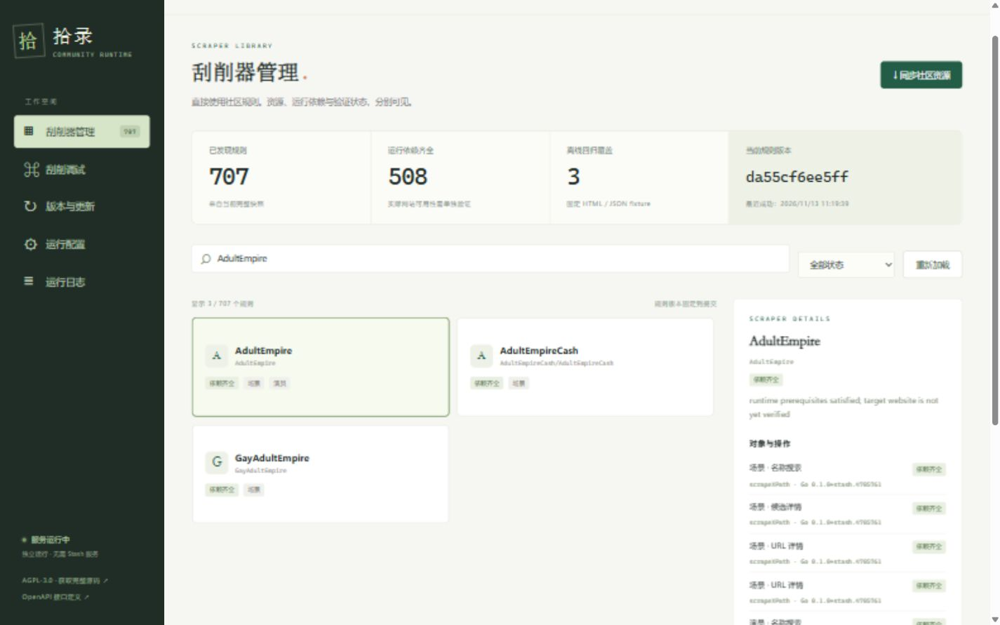
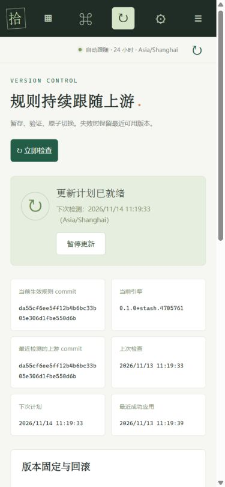

# 实际验证记录

验证日期：2026-11-13，`Asia/Shanghai`。本记录描述本次实际运行结果，不将「定义可加载」「依赖齐全」「离线 fixture 通过」写成目标网站在线可用。

本页主体为最初本机交付的基线记录。后续 GitHub 发布检查以 [Actions](https://github.com/nwfnyfgvfir/stashscrapers/actions)和对应 tag 的工作流日志为准。发布版另外加入容器健康检查命令及 5 个响应场景测试；VPS 安装脚本已通过首次安装、保留凭据、非法参数和升级失败恢复测试。

## GitHub 与镜像发布补充

- **tag 自动发布已验证**：[v0.1.2 自动运行](https://github.com/nwfnyfgvfir/stashscrapers/actions/runs/43386196695)由 Git tag `push` 触发，验证和发布两个 job 均成功。对应源码 commit `9cc4617`，公开镜像 `ghcr.io/nwfnyfgvfir/stashscrapers:v0.1.2`，digest 为 `sha256:51a0962a4a5ba5eaf24e8abc11c6da6ce2baf233c1c3e258ed3f9f57cb9aa0ba`。两个架构 manifest、config 和所有 layer 均通过匿名访问检查。
- [公开仓库](https://github.com/nwfnyfgvfir/stashscrapers)已推送；`v0.1.1` 对应 commit `94607237fc33109aa847a16d788193d5aac9bd05`。
- [Windows / Linux 兼容 CI](https://github.com/nwfnyfgvfir/stashscrapers/actions/runs/43385209462)全部通过，包含完整 Python HTTPS 集成、Linux race、多平台二进制构建及真实 Docker 持久卷重启测试。
- [v0.1.1 发布流水线](https://github.com/nwfnyfgvfir/stashscrapers/actions/runs/43385200335)已通过手动入口实际完成构建和推送。`push.tags` 自动入口也已配置；首次主分支 push 的 CI 约延迟 11 分钟后才创建，本记录不把手动运行冒充 tag 自动触发证明。
- `ghcr.io/nwfnyfgvfir/stashscrapers:v0.1.1` 与当次 `latest` 的多架构 digest 为 `sha256:08dd67149933a39846c7347ec43cfcf483a6872708cf97e5fa29eb8197c0a279`。
- 未提供 GitHub/GHCR 凭据的 registry 请求成功读取多架构索引、两个架构的 manifest，并通过 config 与所有 layer 的匿名 HEAD 检查。支持 `linux/amd64`、`linux/arm64`；amd64 实际运行，arm64 完成构建和发布，未在 arm64 硬件执行。
- 发布镜像压缩 layer 合计约 amd64 **8.07 MiB**、arm64 **7.48 MiB**；这不包含首次启动下载的社区资源，也不是进程内存占用。
- VPS 安装脚本已做受控黑盒测试；没有用户 VPS 地址或凭据，因此没有声称已在用户 VPS 执行部署。

## 版本与执行环境

- Stash 执行层：`47057616fe9da0cf38cfa8c39ab160e5441eeafc`。
- CommunityScrapers 原始配置及共享模块：`da55cf6ee5ff12b4b6bc33b05e306d1fbe550d6b`。
- 引擎：`0.1.0+stash.4705761`。
- Windows amd64：Conda `stashscrapers`，Go `1.25.14`，Python `3.12.14`。Race 检查使用同一 Conda 环境中的 MinGW GCC。
- Linux amd64：在 Conda 中交叉编译测试二进制，再通过 WSL Ubuntu 24.04 执行；未调用 Linux 全局 Go/Python。
- Linux arm64：完成交叉编译，未在 arm64 硬件执行。

## 已通过的功能验证

Windows 完整测试包含 **15 项通过、2 项按需跳过**；两个跳过项为单独执行的 CDP 检查和人工浏览器 fixture 服务。Linux 原生测试二进制包含 **13 项通过、4 项跳过**；跳过 Python/CDP 可选环境与人工服务，不冒充已验证这些 Linux 外部运行时。

实际测试命令：

```powershell
conda run -n stashscrapers python tools/check.py --full
conda run -n stashscrapers python tools/race.py
conda run -n stashscrapers python tools/check_browser.py
conda run -n stashscrapers python tools/check_linux.py
conda run -n stashscrapers python tools/build.py
```

测试覆盖：

- **AdultEmpire 原始 YAML**：真实 HTTP fixture 请求、URL 编码、规则 Cookie、XPath、场景候选列表、显式选择第二个候选、`sceneByQueryFragment` 详情与嵌套制作商/演员。未生成配置中不存在的代码字段。
- **1Pondo 原始 YAML**：GJSON、原始 URL 到 JSON API 的正则重写、按调用方 filename fragment 构造请求、拼接/拆分、日期、演员/标签数组及固定制作商。URL-only 动作不会获得名称搜索能力。
- **Boobpedia 原始 YAML**：performer JSON 搜索、XPath 详情、Go 日期格式、JavaScript 职业日期后处理、图片 subScraper 二次请求。
- **RealJamVR 原始 YAML/脚本**：保留原始脚本参数与 cwd；从 JSON stdin 读取 query，stdout 返回两条候选；原始 `requests.post` 经受控 CONNECT 代理发送真正的 HTTPS 请求，并验证测试 CA。原始脚本与共享模块未修改。每个快照建立独立 venv，验证 Python 导入与依赖；更新后环境路径不同，回滚恢复原路径。
- **取消与限制**：JavaScript 无限循环被 deadline 中断；Python 超时终止，stdout 超限被终止；API 输入、URL 协议、私网目标、伪造包含域名的 URL 与跨域管理请求被拒绝；Cookie/API Key/敏感请求头读取脱敏。
- **CDP 单独测试**：使用已安装 Chromium 的临时 headless 配置文件，连接服务可选 CDP 适配，等待 JavaScript 生成 DOM，再用 XPath 返回标题；自定义凭据只发送到规则域名，未转发到另一域名的图片请求。原始 Anime-DB 在无 CDP 配置时正确报告缺少依赖。未声称 Anime-DB 在线网站验证通过。
- **Race 检查**：`tools/race.py` 通过。其默认套件不重复安装 Python 依赖，完整 Python 集成由独立完整测试覆盖。

## 自动更新与回滚证明

模拟上游提供真实仓库元数据、commit 条件请求与 tar.gz 下载端点，测试实际运行服务内部计划器：

- 自动读取 `actual-default` 默认分支，未写死 main/master。
- 每日默认间隔为 24 小时，检测计划持久化；重启不会立即再次请求上游。
- 受控时钟推进到计划点后，内部定时器自动检查并应用新提交，无需用户点击。
- 新增、删除、改名完整同步；共享资源与 YAML 同一版本切换，旧文件不残留；删除但存在设置的规则显示明确状态。
- 下载截断、危险压缩包路径、链接、无效 YAML/动作及已启用规则不兼容时，活跃版本保持不变。
- GitHub 实际归档中的全局 PAX 元数据头可正确读取，且不放宽路径校验。
- 验证失败的提交不会重复下载，之后的修复提交仍能安装。
- Cookie、API Key 与启用状态不被更新覆盖。
- 运行中的请求继续返回旧规则版本，新请求使用新快照；旧目录不被覆盖。
- 回滚恢复保留快照并固定 24 小时，手动检查不会立即重装已回退的提交。
- 上游关闭后仍可从已有资源启动。
- 日程时区与更新锁也有独立测试。

## 实际 GitHub 初始化

本机服务实际读取 GitHub 仓库默认分支 `master`，下载并安装完整 `da55cf6…` 快照。当前目录发现 **707 个定义**；默认环境中约 **508 个定义至少有一个动作满足运行前提**。这些数字是目录与依赖检测结果，**不是 508 个网站通过在线验证**。确切逐动作状态以服务当前 API 为准。

首次空数据启动的 HTTP 监听日志为约 **27 ms**；规则在后台初始化。成功下载到应用完整快照的一次观察为约 **5.4 s**，受网络环境影响，不是稳定基准。

## 浏览器端到端检查

实际打开内嵌页面，检查真实 API 展示、按名称过滤、规则详情与能力、更新历史、暂停/恢复每日更新。另在明确的测试 fixture HTTP 服务中完成「搜索 → 两条候选 → 手动选择第二条 → 详情与原始 JSON」。测试服务没有链接到生产启动命令，也不替代生产页面数据。

检查了 `1440 × 900` 与 `390 × 844`，移动端未发现横向溢出，浏览器未记录 JavaScript 控制台错误。截图为真实运行页面：





## 在线冒烟结果：未通过

通过运行中的服务分别请求 1Pondo URL、Boobpedia 名称搜索、AdultEmpire 名称搜索，均返回 `502 network_error`。单次用时约 `0.4 s / 10.0 s / 10.0 s`；没有得到在线元数据结果，无法据此判断目标规则当前是否正确。

原始独立记录由 `tools/online_smoke.py` 写入本机 `test-output/online-smoke.json`，不混入离线通过率，不包含目标元数据或凭据。网络错误未触发规则版本回滚。

## 资源测量与构建

`tools/measure.py` 在独立复制的数据目录中测量，关闭其更新计划，不改生产配置。已安装 707 个定义、无 Python/CDP 常驻进程的一次 Windows 样本：

- HTTP 健康且资源 ready：约 **11.3 s**；进程内部启动日志约 **11.2 s**，包含完整目录加载。
- 空闲 3 秒后的进程工作集：约 **30.0 MiB**，私有内存约 **32.6 MiB**。
- Windows 独立二进制：约 **19.1 MiB**；Linux amd64 约 **18.6 MiB**，Linux arm64 约 **17.7 MiB**。最终精确字节数与 SHA-256 见 `dist/SHA256SUMS` 和构建输出。

这是单机、单样本测量，运行时负载、文件系统缓存及安全软件会影响启动与内存。完整社区目录加载明显慢于空目录启动；未声称达到毫秒级完整资源启动。测量细节保存于本机 `test-output/metrics.json`。

**Docker 已在 GitHub Actions 实际构建并运行**：本工作站仍未安装 Docker；远程 Linux runner 的 [容器测试日志](https://github.com/nwfnyfgvfir/stashscrapers/actions/runs/43385209462/job/131751957645)确认非 root 启动、健康探针、缺少 Token 返回 401、配置写入及重启后持久卷恢复均通过。该 runner 的 `docker image inspect --format '{{.Size}}'` 返回 **8,471,479 字节，约 8.08 MiB**。这是一次 amd64 镜像的 Docker 报告值，不代表 VPS 实际磁盘占用或运行内存。容器 smoke 检查 HTTP 服务健康，不等待完整社区规则下载；规则语义由独立完整测试覆盖。

首轮 `v0.1.0` 测试在重启后的主机访问失败，镜像没有发布。`v0.1.1` 修复测试脚本：Docker 重启后重新读取随机分配的主机端口，失败时输出容器日志和状态。修复后真实重启测试已通过，旧 tag 保持不变。

## 尚未实际运行与已知边界

- 远程 Linux 完整兼容测试、Python HTTPS 集成、race、VPS 安装脚本测试及容器 smoke 已实际通过；GHCR 发布和公开拉取以对应 [发布工作流](https://github.com/nwfnyfgvfir/stashscrapers/actions/workflows/release.yml)及匿名 registry 检查为准。没有访问或部署用户未提供的 VPS。
- [每日引擎检查已手动实跑](https://github.com/nwfnyfgvfir/stashscrapers/actions/runs/43384734225)，确认固定引擎与当前上游一致，无需提取或发布。仓库变量 `AUTO_RELEASE_ENGINE=true` 已设置；未声称模拟了未来上游引擎变更或实际 VPS 自动换版。
- 当前只审核开放 RealJamVR 的 Python 动作。其他脚本的独立依赖/完整 Stash API 关系未全部验证，因此明确不支持。
- `action: stash`、Stash 数据库/媒体库、`useSurf`、JSON + CDP 均不支持。没有媒体扫描、播放或转码。
- CDP 浏览器的网络隔离与代理由其部署负责；Python 与 CDP 需明确承认独立网络边界。Python venv 回滚依赖其基础解释器继续存在。
- 每次更新使用固定真实规则回归，不代表对全部 707 个定义进行了网站抓取测试。上游新增能力或站点变化仍可能要求人工适配。
- 日常规则可自动跟随，但不承诺永久零维护或所有网站始终可用。
